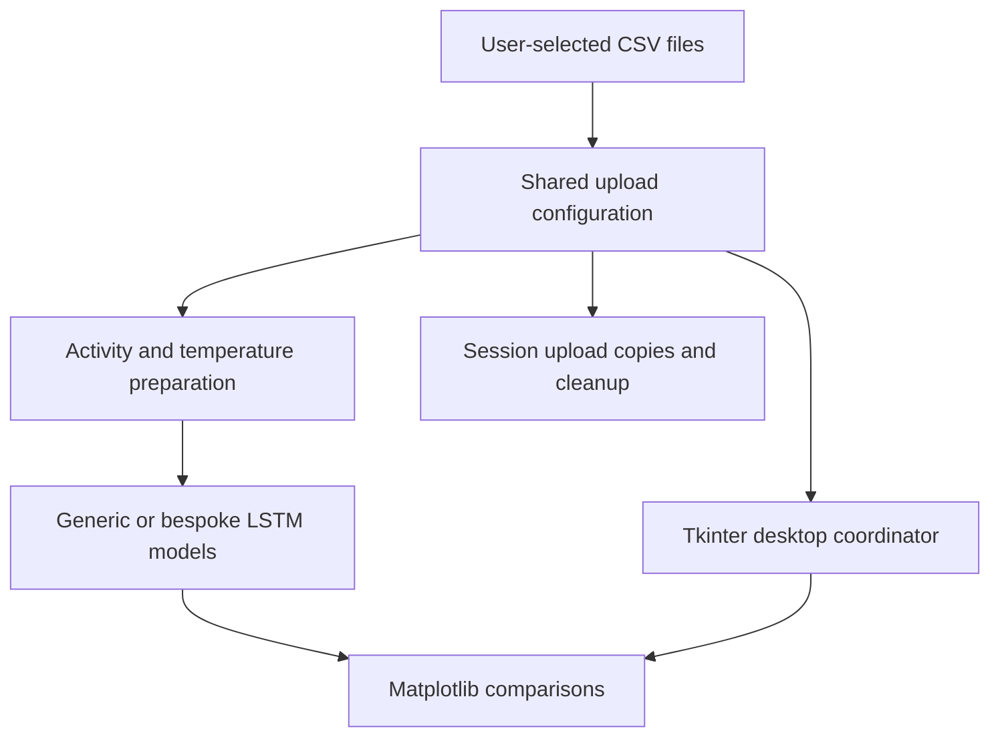

# Dairy time-series desktop architecture

Maintenance review: **11 November 2026**. Inspected base commit: `ba5e7a92f6add180e76d5c533654ea80fe92caa5`.

Academic-style desktop source for dairy-herd activity and temperature modelling. The repository contains legacy experiments and model files; the maintenance work is dated 11 November 2026 and does not rewrite the original research history.

## Current implementation

| Source boundary | Responsibility and implementation status |
| --- | --- |
| `Codes/main.py` | Desktop coordinator and on-close session cleanup. |
| `Codes/upload_data.py; leftbuttons.py; data_utils.py` | Two legacy upload views now share one persistence implementation. |
| `Codes/Generic_*; BeSpoke_*` | Separate experiment and model paths, including legacy commented sections. |
| `Codes/visualize_uploaded_data.py; visualizebutton.py` | Per-cow plots and comparison screens. |

## Changes in this maintenance pass

Upload settings, session data and cleanup now resolve against the code directory instead of the launch working directory. Duplicated loaders/writers were replaced with shared `data_utils` imports. Configuration writes use a flushed temporary file plus atomic replace, keeping the previous JSON intact if serialization fails. Legacy relative CSV paths resolve against the config directory.

## Verification and repeatable checks

`python -m unittest discover -s tests -v` checks launch-directory independence, failed-write preservation and invalid config shape. These are persistence checks; they do not execute TensorFlow training, load H5 artifacts or validate veterinary thresholds.

Record the exact commit and hosted workflow result when reviewing a change. Passing a focused regression does not establish end-to-end reliability or measured capacity.

## Scale and ownership decisions

These are explicit **future design steps**, not implemented infrastructure or measured capacity claims.

| Pressure or boundary | Decision and next evidence |
| --- | --- |
| Maintainability | Separate the two uploader views from a common controller, isolate model preparation and replace the historical dependency dump with a measured minimal environment in a future tested migration. |
| Desktop responsiveness | Run training in bounded worker jobs; marshal UI updates through Tkinter callbacks. Validate schemas, cow IDs, timestamp order and units before inference. |
| Multiple users | Move mutable files to a user-scoped workspace with per-session IDs and retention rules before concurrent use; use a service boundary only if remote access is actually needed. |

Keep one owner for each data contract, centralize paths/configuration, and review dependency changes with the smallest relevant regression suite. Separate computed results from static fixtures; version inputs with artifacts. Before release, reproduce setup from a clean checkout and check both failure paths and resource cleanup.

## Operational limits and recovery

The committed source references a missing `Codes/photo` asset directory, includes Windows-only `os.startfile` viewers and a large historical environment dump. Full desktop startup is therefore not established. The shared code directory remains a single-user state boundary, and original user CSV files may still be selected outside it.

Keep a known-good commit and backup mutable experiment artifacts before running migrations or training. On failure, preserve the error and input/configuration version; restore the prior artifact set or checkout the known-good code before retrying. No cloud deployment, paid service provisioning, data migration or production-scale load test was performed by this maintenance pass.
