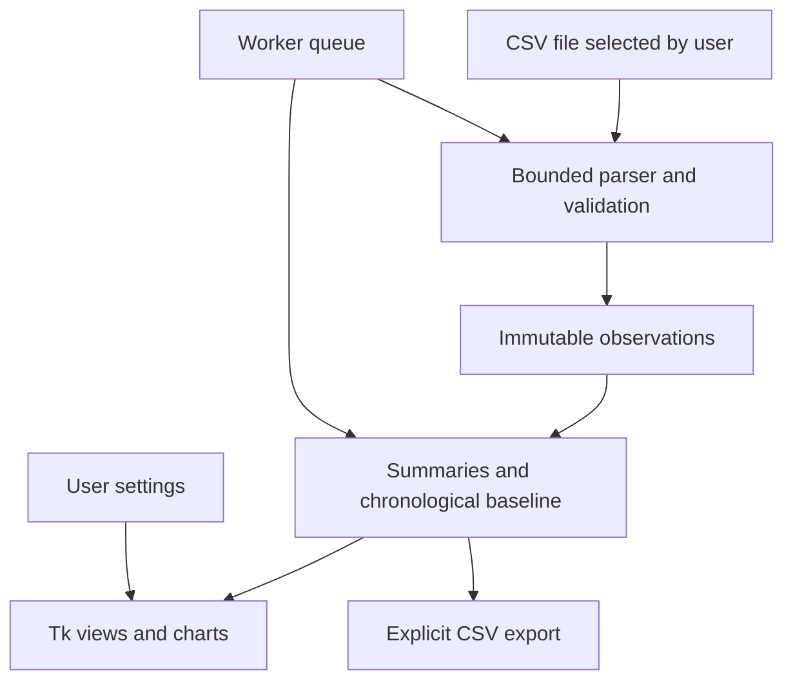

# DHMS Desktop architecture

The supported desktop edition is a later, AI-assisted application dated 14 November 2026. It is separate from the assessed 2024 neural-network research source under `Codes/` and the byte-preserved supporting import under `original-work/`.

## Responsibilities

The parsing and analysis layer has no Tk dependencies. Tk widgets are updated on the main UI thread; background work reports results through a queue polled with `after`. Immutable datasets prevent partially parsed files from replacing the current view. Selecting a new file or closing the application cancels or disregards stale work. User-owned source files are read-only.

The desktop application has no backend server, login, telemetry or cloud data upload. A separate process runs for each user. Packaging bundles the Python/Tk runtime and synthetic sample so users do not install TensorFlow or recreate the historical author's environment.

## Data contract and evaluation

The canonical CSV is a long table: `timestamp,cow_id,activity,temperature`. At least one metric must be supplied. Headers and values are validated, numeric values must be finite and records are ordered by timestamp per cow. Source adapters support explicitly documented legacy formats. The parser reports row-level errors instead of silently accepting a partially valid dataset.

Descriptive statistics are calculated per selected cow and metric. The baseline predicts each held-out observation using only earlier observations in its trailing window. Its MAE is a backtest result on the selected data, not a neural-model score or an animal-health diagnosis. Baselines are labelled throughout the interface and exports.

## Workload and scaling

This is a bounded local application. Imports are capped at 20 MiB, 100,000 records and 500 cows; charts display a bounded subset while analyses retain accepted observations. These are protective limits, not measured claims of low latency at maximum capacity. Large files fail with an explanatory message. Background work keeps input handling separate from parsing and calculations.

For larger herds, next steps would include an indexed local database, streaming aggregation and separately benchmarked analysis workers. A multi-user hosted service would require its own identity, authorisation, tenancy, job scheduling, storage and operational design. None is implied by the desktop package.

## State and failure recovery

Preferences are saved in the user's application-data directory with atomic replacement. Installation folders and the repository are not treated as writable runtime storage. Exports are explicitly requested, written atomically, and neutralise spreadsheet formula prefixes in text fields. A failed import leaves the previous dataset usable. Closing the application never recursively deletes source data.

## Why the historical GUI is not the packaged entry point

The old GUI references missing decorative images, local Desktop paths, hardcoded herd sizes and incomplete model/scaler artifacts. Training executes on the UI thread. Some historical evaluation calculates an apparent score by comparing predictions to themselves, and scaling is performed before chronological splitting. These defects prevent an honest portable inference release.

The supported edition resolves the portable data-exploration workflow without presenting unvalidated historical models as working clinical features. Original research files and model artifacts remain available for study. Re-enabling neural training/inference requires reproducible preprocessing, a versioned model/schema/scaler bundle, leakage-free held-out evaluation and explicit failure tests.

## Release and verification

The desktop workflow runs parser, storage and analysis regressions, GUI smoke checks and native package builds. Platform packages are built on their own operating systems, not cross-compiled. Each archive has a SHA256 sidecar. A release is published only from a matching desktop version tag whose source is reachable from main; asset upload waits for all platform builds.

Packages are unsigned. OS signing/notarisation and testing on arbitrary laptop configurations are not established. Checksums detect accidental changes but do not replace code signing. Consult [download instructions](DESKTOP_DOWNLOADS.md) for the supported platform labels and source alternative.
