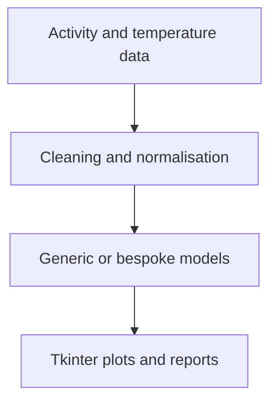
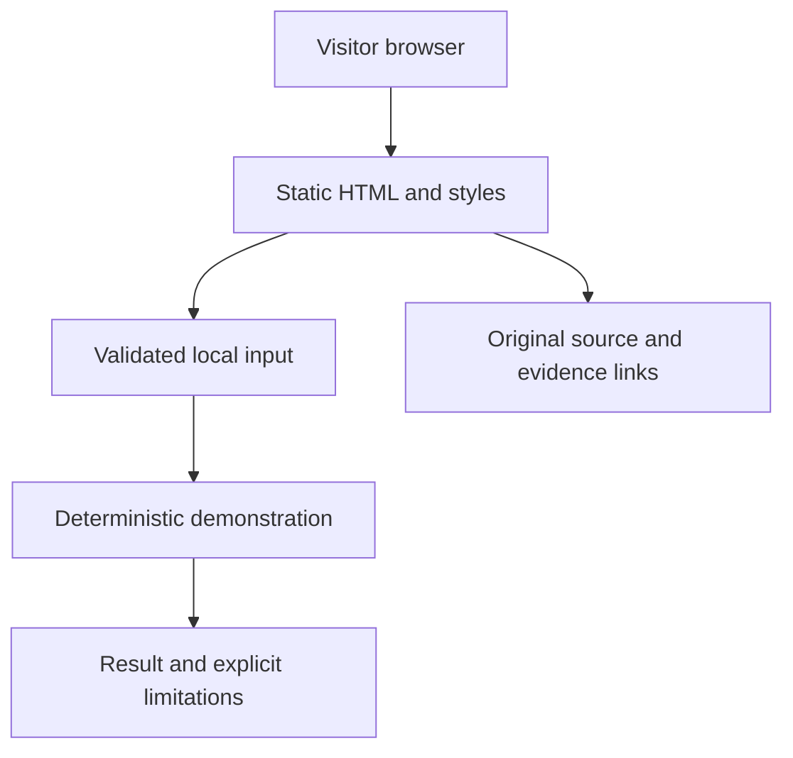

# Engineering review — MSc Project

Review date: 14 November 2026. This document records the current portfolio edition and proposed engineering improvements separately from the assessed academic work.

## Original system

Investigate dairy-herd activity and temperature through a desktop research suite for data upload, neural-model training and visualisation. The original delivery is **Tkinter research application**. Existing source files, desktop interfaces and relational/data schemas remain authoritative for reproducing the historical implementation.

## Decision 1: Preserve provenance

Keep the assessed source and any group contribution boundaries intact. Add a browser workbench and engineering explanation as a later portfolio edition. Do not relabel the new edition with the original module mark or overwrite the academic evidence. Tradeoff: two surfaces require explicit documentation, but reviewers can distinguish reproducible source from demonstrations.

## Decision 2: Make the boundary explicit

Keep model training and data processing separate from Tkinter callbacks. A long-running fit should report progress through a queue, while only the main GUI thread updates widgets.

Desktop execution keeps research files local and allows specialised Python libraries. A future service adds remote access but introduces model-job scheduling, access control and dataset governance requirements.

## Data and interface contracts

Record animal identifier, measurement time, activity and temperature with units. Evaluate on later time periods and unseen animals where appropriate; fit preprocessing on training data only.

The original research prototype is not a validated veterinary diagnostic service. The browser workbench compares a trailing-mean baseline on invented activity values; it is not the original neural network and its MAE is illustrative.

## Current web architecture

The web edition is buildless HTML, CSS and JavaScript. It loads a fixed, synthetic example where needed and performs bounded calculations in the browser. User-entered strings are rendered through text nodes; no submitted value is evaluated as source code. It has no analytics, external API calls, database writes or credential requirement. Input state lasts only for the current page session.

## Deployment architecture

Local preview uses a static HTTP server. The intended Sites deployment serves the same `web/index.html` and associated assets. As of this review, Sites publication is pending; the source repository link is not a deployment receipt. A Python/PHP/desktop runtime is not silently hosted by deploying this static page.

A future hosted original application needs a separately described service boundary: authenticated request handling; schema validation; configuration and secret management; bounded workloads; persistent storage ownership; structured errors; audit-safe logs; backup/restore; deployment rollback; and explicit operational responsibility. For training jobs, use a queue and durable job status rather than keeping an HTTP request open. These are proposed requirements, not implemented services.

## Verification strategy

1. Review links and academic figures against the verified module map.
2. Validate browser inputs at their boundary: blanks, malformed values, out-of-range numbers and non-finite values.
3. Compare numerical examples against independent known answers; keep labels clear about synthetic data.
4. Check keyboard navigation, visible focus, readable contrast and small-screen layout.
5. Run the original repository’s documented checks separately. A successful browser demonstration does not prove that the historical GUI, hardware integration or modelling environment starts successfully.

The edition uses semantic headings, labelled form controls, a live result region, responsive layout and reduced-motion support. Browser execution and original-application checks must be reported only when actually completed.

## Operations and failure handling

Keep real datasets, academic identifiers, access tokens and session exports outside the published source. A malformed workbench input produces an explanatory local error. The demo state can be reset by reloading. Static deployment rollback should restore a previously saved, verified version. Before deploying an original backend, define recovery objectives based on the actual users and data rather than inventing uptime guarantees.

## Known limitations

The original research prototype is not a validated veterinary diagnostic service. The browser workbench compares a trailing-mean baseline on invented activity values; it is not the original neural network and its MAE is illustrative. Missing university-issued documents remain marked missing. No unavailable assessment component marks, model scores, benchmarks or production claims have been inferred from the final module result.

## Consolidation verification and maintenance workflow

The supporting Dairy Herd source is preserved at `original-work/Dairy-Herd-Monitoring/`.
Its manifest now distinguishes the original commit from the Git tree, and
`python scripts/verify_import.py` checks all 22 imported files using raw-byte sizes
and Git blob hashes. Run this before and after maintenance; do not silently edit
the preserved snapshot. The source repository has not been deleted by this change.

CI runs the root persistence/provenance regressions, the imported sequence tests
and `node web/verify.cjs` as separate jobs. This prevents the nested tests being
silently omitted by root-only unittest discovery. None of these checks establishes
full GUI startup or model accuracy.

The short root `AGENTS.md` supplies project scope, preservation rules and exact
verification commands. This applies the repository-specific guidance and observed
evidence principles from OpenAI's [Iterating Development Workflows with Codex](https://developers.openai.com/cookbook/examples/codex/iterating-development-workflows-with-codex).
The existing application uses classical time-series/neural-model code and a static
browser demonstration. No OpenAI API, agent service or credential was added.
