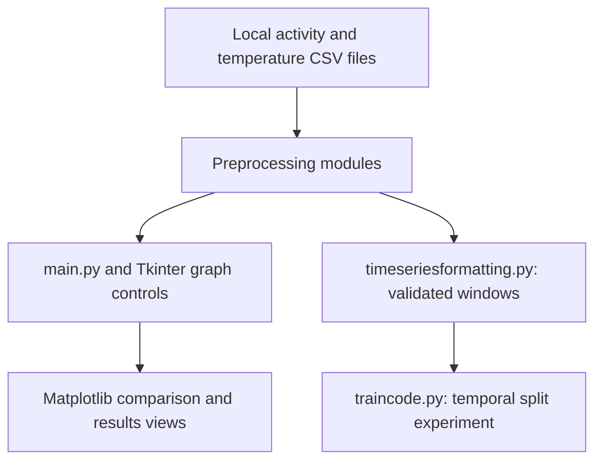

# Dairy herd monitoring prototype: architecture and maintenance

Reviewed source: `b6a408c0f3a4de72d4077ab626a489b686093c30`. Maintenance date: 11 November 2026. This document describes inspected code, the bounded fixes in this change and future work separately. It does not establish production deployment or measured scale. Original coursework/learning material and prior authorship remain identifiable; this maintenance was AI-assisted.

## Implemented architecture



| Component | Source | Responsibility |
| --- | --- | --- |
| Desktop view | main.py, leftbuttons.py, rightbuttons.py and graph modules | Local CSV selection and cow activity/temperature visualization. |
| Preprocessing | activitypreprocessing.py, temppreprocessing.py | Historical local data preparation. |
| Maintained sequence preparation | timeseriesformatting.py | Explicit CSV CLI, reusable validated sequence functions and date alignment. |
| Training experiment | traincode.py | Loads local NumPy artifacts and performs temporal split; not a deployed predictive service. |

## Engineering decisions in this change

Sequence preparation no longer reads a personal absolute path on import. Very short datasets now use a window smaller than the dataset, guaranteeing at least one target. Invalid window bounds, nonfinite features and date misalignment fail clearly. The CLI requires chronological dates and an explicit source CSV.

## Reproduce checks and run

Run from the repository root with Python 3.12 or Node 22 as appropriate. Use a virtual environment before installing Python dependencies.

```bash
python -m pip install -r requirements-sequences.txt
```

```bash
python -m unittest discover -s tests -v
python timeseriesformatting.py /path/to/preprocessed_activity_data.csv
```

3 regressions cover short-data windows, target/date alignment, invalid sizes, NaNs and missing date alignment. No real herd dataset or trained model is required.

## Current boundaries

Other historical GUI/preprocessing modules still assume local assets/paths. This is an exploratory animal-monitoring application, not a veterinary diagnosis system. The sequence CLI reports shapes and does not persist model artifacts; no trained-model or accuracy result is claimed. Overlapping windows need careful evaluation split boundaries to avoid leakage.

## Scaling path and acceptance evidence

Stream or use sliding-window views rather than materializing all windows for large histories; validate identical targets/dates first. Partition by cow/date, preserve chronological order and isolate train/test periods before fitting preprocessing. Store sensor timestamps and data-quality rules in a versioned schema. Add bounded worker tasks for preprocessing and keep UI updates on the Tkinter thread. Measure peak memory versus rows, cows and window length.

## Maintenance and recovery

Keep data and credentials out of source changes. Reproduce a failure with synthetic inputs before modifying a transformation or user action. Run the focused CI checks, review changes to input/output contracts and retain the prior commit for rollback. Back up local CSV/database inputs outside the working tree before manual runs. Revert the maintenance commit to roll back code; preserve data separately because reverting code does not reverse data mutations. Record environment versions, input schema, failure steps and expected/actual behavior in future bug reports.
